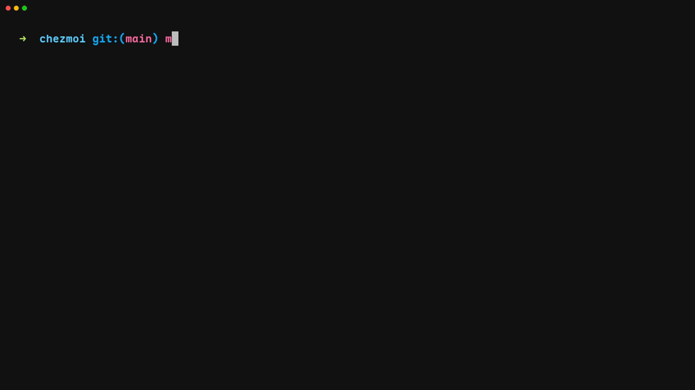
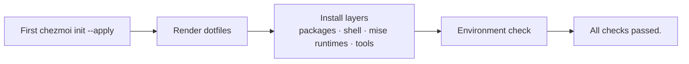

<p align="center">
  <picture>
    <source media="(prefers-color-scheme: dark)" srcset="docs/assets/logo-dark.svg">
    
  </picture>
</p>

<p align="center">
  <strong>One command turns a clean machine into a ready-to-code development environment.</strong><br>
  macOS · Ubuntu / Debian · Arch Linux · native Windows — managed by <a href="https://www.chezmoi.io/">chezmoi</a>
</p>

<p align="center">
  <a href="https://github.com/kangmingxuan/oh-my-devenv/actions/workflows/ci.yml"></a>
  <a href="LICENSE"></a>
  
</p>

<p align="center">
  <a href="#quick-start">Quick start</a> ·
  <a href="#what-you-get">What you get</a> ·
  <a href="#safe-to-try">Safe to try</a> ·
  <a href="docs/README.md">Docs</a> ·
  <a href="README.zh.md">中文</a>
</p>

<p align="center">
  
</p>

## What you get

<table>
  <tr>
    <td width="50%" valign="top"><strong>One command</strong><br><code>chezmoi init --apply</code> installs every layer through ordered hooks. The first apply ends with an environment check. Re-running is safe.</td>
    <td width="50%" valign="top"><strong>One source for supported platforms</strong><br>macOS (Intel and Apple Silicon), Ubuntu / Debian, and Arch Linux share one templated baseline. Native Windows has its own hooks.</td>
  </tr>
  <tr>
    <td valign="top"><strong>Pinned runtimes</strong><br>Go, Node, Python, and golangci-lint through <a href="https://mise.jdx.dev/">mise</a>, plus <code>gopls</code>, <code>dlv</code>, <code>ruff</code>, <code>basedpyright</code>, and <code>pre-commit</code>.</td>
    <td valign="top"><strong>Shells that feel finished</strong><br>On macOS and Linux: Zsh with oh-my-zsh, autosuggestions, syntax highlighting, and generated completions, plus managed Bash on Linux. On Windows: PowerShell with Oh My Posh and completions.</td>
  </tr>
  <tr>
    <td valign="top"><strong>Modern CLI toolkit</strong><br>On macOS and Linux: ripgrep, fd, bat, fzf, jq, direnv, tmux, shellcheck, shfmt, and more. Windows gets a smaller WinGet set.</td>
    <td valign="top"><strong>Secrets stay local</strong><br>Credentials, private hosts, and machine-only values live in local overlays, so the public baseline is safe to clone.</td>
  </tr>
  <tr>
    <td valign="top"><strong>Optional desktop baseline</strong><br>Maple Mono NF CN on every desktop-baseline platform. Ghostty on macOS and supported Linux, plus OrbStack on macOS. PowerToys and Windows Terminal settings on Windows. You choose it once at first run.</td>
    <td valign="top"><strong>Backed up and removable</strong><br>The first apply backs up the contents of existing files at managed paths. An uninstall script previews the files and directories it can remove, then removes them on confirmation.</td>
  </tr>
</table>

## Quick start

### macOS and Linux

**1. Install `git`, `curl`, and `chezmoi`.**

<details open>
<summary><b>macOS</b></summary>

```bash
if ! command -v brew >/dev/null 2>&1; then
  /bin/bash -c "$(curl -fsSL https://raw.githubusercontent.com/Homebrew/install/HEAD/install.sh)"
fi
if [[ -x /opt/homebrew/bin/brew ]]; then
  eval "$(/opt/homebrew/bin/brew shellenv)"
elif [[ -x /usr/local/bin/brew ]]; then
  eval "$(/usr/local/bin/brew shellenv)"
fi
brew install git curl chezmoi
command -v git curl chezmoi
```

</details>

<details>
<summary><b>Ubuntu / Debian</b></summary>

```bash
sudo apt-get update
sudo apt-get install -y git curl
sh -c "$(curl -fsLS get.chezmoi.io)" -- -b "$HOME/.local/bin"
export PATH="$HOME/.local/bin:$PATH"
command -v git curl chezmoi
```

</details>

<details>
<summary><b>Arch Linux / Omarchy</b></summary>

```bash
sudo pacman -Syu --needed git curl chezmoi
command -v git curl chezmoi
```

Keep Arch fully upgraded before you apply. The bootstrap does not refresh the
package databases or upgrade the whole system.

</details>

Continue when the last line prints a path for each of `git`, `curl`, and `chezmoi`.
Run step 2 in the same terminal.

> [!IMPORTANT]
> Leave `XDG_CONFIG_HOME` unset, or set it to exactly `$HOME/.config`. Apply
> stops on any other value.

**2. Apply the baseline.**

```bash
chezmoi init --apply https://github.com/kangmingxuan/oh-my-devenv.git
```

Use `git@github.com:kangmingxuan/oh-my-devenv.git` instead if you clone over SSH.
chezmoi asks for your Git name, email, and whether to install the desktop
baseline. On Linux, the system package step asks for `sudo`.

**3. Check the result.** Look for `All checks passed.` in the
environment-check summary. Open a new terminal so that your shell picks up the new tools.

### Native Windows Quick Start

<details>
<summary><b>Show the Windows steps</b></summary>

Install the prerequisites with winget:

```powershell
winget install --id Microsoft.PowerShell --exact --source winget
winget install --id Git.Git --exact --source winget --scope user
winget install --id twpayne.chezmoi --exact --source winget
```

Open a new PowerShell (`pwsh`) session. Confirm that the version is 7.6 or
later, and that Git, OpenSSH, chezmoi, and winget are on `PATH`:

```powershell
$PSVersionTable.PSVersion
Get-Command git, ssh, chezmoi, winget -CommandType Application
Get-ExecutionPolicy
```

If `ssh` is missing, enable the Windows OpenSSH Client optional feature or put an
available OpenSSH client on `PATH`. For the
desktop baseline, Windows Terminal must be on `PATH`. Then apply:

```powershell
chezmoi init --apply https://github.com/kangmingxuan/oh-my-devenv.git
```

After apply succeeds, open a new `pwsh` terminal to load the prompt and
completions. If device policy blocks the hooks, the `winget` source, or an
installer, stop and contact your device administrator. See
[Native Windows](docs/01-onboarding.md#native-windows) for what apply installs,
backups, checks, and uninstall.

</details>

Building Linux software on Windows? Apply the macOS and Linux steps inside an
Ubuntu WSL distribution instead. See
[Native Windows and WSL](docs/01-onboarding.md#native-windows-and-wsl) to pick
the right one.

## Safe to try

The commands in this section are for macOS and Linux. On native Windows, see
[Native Windows](docs/01-onboarding.md#native-windows) for the backup path, the
check, and uninstall.

- **Preview first.** On a machine without a chezmoi source, run
  `chezmoi init <repo-url>` without `--apply`, then `chezmoi diff` to see the
  file changes. Run `chezmoi apply` when you are ready. If the chezmoi source
  directory already holds a Git checkout, `init` reuses it; check that checkout
  and its remote before you continue.
  The diff leaves out the install hooks; the
  [hook list](docs/01-onboarding.md#what-to-expect-during-apply) describes them.
- **Your files are backed up.** The first apply copies the contents of existing
  files at managed paths to
  `${XDG_STATE_HOME:-$HOME/.local/state}/chezmoi-first-run-backup/<timestamp>/`.
  It follows symlinks and skips dangling ones.
- **Remove it with one script.** `bash "$(chezmoi source-path)/bootstrap/scripts/uninstall.sh"`
  previews the files and directories it would remove, including `~/.oh-my-zsh`.
  Review the whole list, especially if you already use Oh My Zsh. Add
  `--confirm` to archive and remove them. Installed packages and runtimes stay.
  The script does not restore your previous files. To restore files saved on
  the first apply, extract `tree-chezmoi-first-run-backup.tgz` from the
  uninstall backup directory into a separate directory. Then copy the files you
  need from its timestamped backup back to their original paths. See
  [disposable environment reset](docs/03-maintenance.md#disposable-environment-reset).
- **Coming from another dotfiles setup?** Read the reset notes linked above
  before you apply. On a restricted network, start from the
  [local overlay examples](docs/local-overlay-examples/README.md).

## How it works



chezmoi renders your dotfiles, then runs ordered hooks. The hooks read package
and tool manifests under `bootstrap/manifests/` and runtimes from the managed
mise configuration. On macOS and Linux, a later apply can skip the final check;
run the check command below to verify at any time. The
[onboarding guide](docs/01-onboarding.md) walks through each hook.

## Everyday commands

| Task | Command |
| --- | --- |
| Pull the latest source and reapply | `chezmoi update` |
| Reapply after you edit the local source | `chezmoi apply` |
| Check the environment without applying configuration or installing tools (macOS and Linux) | `bash "$(chezmoi source-path)/bootstrap/scripts/check.sh"` |

Native Windows uses the PowerShell check in
[Native Windows](docs/01-onboarding.md#native-windows).

Updating an installation from before 0.3.0? Follow the
[0.3.0 migration steps](CHANGELOG.md#030---2026-11-23) before `chezmoi update`.

## Scope

oh-my-devenv is one maintainer's opinionated baseline for laptops, VMs, and
disposable environments, maintained on a best-effort basis. It carries one
current design rather than compatibility profiles. When its choices fit, it
takes a clean machine to a working shell, runtimes, and CLI toolchain quickly.
When they do not, fork it or borrow the parts you like.

## Documentation

- [Onboarding](docs/01-onboarding.md) — prompts, hook order, success signals, and troubleshooting.
- [Local overlay examples](docs/local-overlay-examples/README.md) — templates for private and machine-only values.
- [Documentation map](docs/README.md) — every guide in one place.
- [Contributing](CONTRIBUTING.md) — scope rules and secret hygiene.
- [Changelog](CHANGELOG.md) — user-visible changes by release.

## License

Released under the [MIT License](LICENSE).
