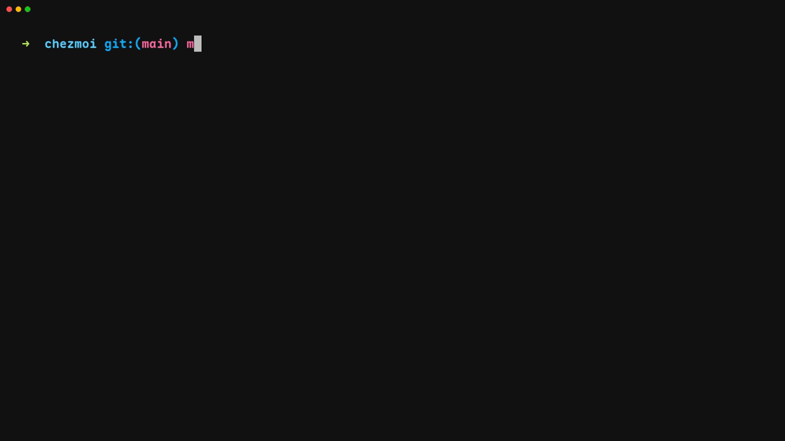
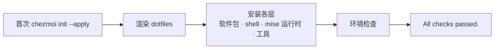

<p align="center">
  <picture>
    <source media="(prefers-color-scheme: dark)" srcset="docs/assets/logo-dark.svg">
    
  </picture>
</p>

<p align="center">
  <strong>一条命令，把全新机器变成开箱即用的开发环境。</strong><br>
  macOS · Ubuntu / Debian · Arch Linux · 原生 Windows —— 由 <a href="https://www.chezmoi.io/">chezmoi</a> 统一管理
</p>

<p align="center">
  <a href="https://github.com/kangmingxuan/oh-my-devenv/actions/workflows/ci.yml"></a>
  <a href="LICENSE"></a>
  
</p>

<p align="center">
  <a href="#快速开始">快速开始</a> ·
  <a href="#你会得到什么">你会得到什么</a> ·
  <a href="#放心试用">放心试用</a> ·
  <a href="docs/README.md">文档</a> ·
  <a href="README.md">English</a>
</p>

<p align="center">
  
</p>

## 你会得到什么

<table>
  <tr>
    <td width="50%"><strong>一条命令</strong><br><code>chezmoi init --apply</code> 通过有序 hook 安装每一层。首次 apply 最后会运行环境检查。重复运行是安全的。</td>
    <td width="50%"><strong>一份来源，覆盖受支持的平台</strong><br>macOS（Intel 和 Apple Silicon）、Ubuntu / Debian 与 Arch Linux 共用一套模板化基线。原生 Windows 有自己的 hook。</td>
  </tr>
  <tr>
    <td><strong>锁定版本的运行时</strong><br>通过 <a href="https://mise.jdx.dev/">mise</a> 管理 Go、Node、Python 与 golangci-lint，外加 <code>gopls</code>、<code>dlv</code>、<code>ruff</code>、<code>basedpyright</code> 和 <code>pre-commit</code>。</td>
    <td><strong>顺手的 shell</strong><br>macOS 和 Linux：Zsh 带 oh-my-zsh、自动建议、语法高亮和生成的补全，Linux 上还管理 Bash。Windows：PowerShell 带 Oh My Posh 和补全。</td>
  </tr>
  <tr>
    <td><strong>现代 CLI 工具箱</strong><br>macOS 和 Linux：ripgrep、fd、bat、fzf、jq、direnv、tmux、shellcheck、shfmt 等。Windows 安装一套较小的 WinGet 工具。</td>
    <td><strong>私密信息留在本地</strong><br>凭据、私有主机和机器专属值放在本地 overlay 中，公开基线可以放心克隆。</td>
  </tr>
  <tr>
    <td><strong>可选桌面基线</strong><br>支持桌面基线的平台安装 Maple Mono NF CN。macOS 和受支持的 Linux 安装 Ghostty，macOS 额外安装 OrbStack。Windows 安装 PowerToys 和 Windows Terminal 设置。首次运行时选择一次即可。</td>
    <td><strong>有备份，可移除</strong><br>首次 apply 会备份受管路径上已有文件的内容。卸载脚本先预览它可能移除的文件和目录，确认后再移除。</td>
  </tr>
</table>

## 快速开始

### macOS 和 Linux

**1. 安装 `git`、`curl` 和 `chezmoi`。**

<details open>
<summary><b>macOS</b></summary>

```bash
if ! command -v brew >/dev/null 2>&1; then
  /bin/bash -c "$(curl -fsSL https://raw.githubusercontent.com/Homebrew/install/HEAD/install.sh)"
fi
if [[ -x /opt/homebrew/bin/brew ]]; then
  eval "$(/opt/homebrew/bin/brew shellenv)"
elif [[ -x /usr/local/bin/brew ]]; then
  eval "$(/usr/local/bin/brew shellenv)"
fi
brew install git curl chezmoi
command -v git curl chezmoi
```

</details>

<details>
<summary><b>Ubuntu / Debian</b></summary>

```bash
sudo apt-get update
sudo apt-get install -y git curl
sh -c "$(curl -fsLS get.chezmoi.io)" -- -b "$HOME/.local/bin"
export PATH="$HOME/.local/bin:$PATH"
command -v git curl chezmoi
```

</details>

<details>
<summary><b>Arch Linux / Omarchy</b></summary>

```bash
sudo pacman -Syu --needed git curl chezmoi
command -v git curl chezmoi
```

apply 之前请先把 Arch 完整升级。引导过程不会刷新软件包数据库，也不会升级整个系统。

</details>

最后一行为 `git`、`curl` 和 `chezmoi` 各打印出一个路径后，再继续。请在同一个终端里执行第 2 步。

> [!IMPORTANT]
> 不要设置 `XDG_CONFIG_HOME`，或者把它设为 `$HOME/.config`。其他任何值都会让 apply 停止。

**2. 应用基线。**

```bash
chezmoi init --apply https://github.com/kangmingxuan/oh-my-devenv.git
```

如果你通过 SSH 克隆，改用 `git@github.com:kangmingxuan/oh-my-devenv.git`。chezmoi 会询问你的 Git 姓名、邮箱，以及是否安装桌面基线。在 Linux 上，安装系统软件包的步骤会请求 `sudo`。

**3. 看到成功信号。** 在环境检查的汇总里找到 `All checks passed.`。打开一个新终端，让 shell 加载新安装的工具。

### 原生 Windows 快速开始

<details>
<summary><b>展开 Windows 步骤</b></summary>

用 winget 安装前置工具：

```powershell
winget install --id Microsoft.PowerShell --exact --source winget
winget install --id Git.Git --exact --source winget --scope user
winget install --id twpayne.chezmoi --exact --source winget
```

打开一个新的 PowerShell（`pwsh`）会话。确认版本不低于 7.6，并且 Git、OpenSSH、chezmoi 和 winget 都在 `PATH` 中：

```powershell
$PSVersionTable.PSVersion
Get-Command git, ssh, chezmoi, winget -CommandType Application
Get-ExecutionPolicy
```

如果缺少 `ssh`，请启用 Windows 的 OpenSSH 客户端可选功能，或者把已有的 OpenSSH 客户端加入 `PATH`。桌面基线要求 Windows Terminal 在 `PATH` 中。然后执行 apply：

```powershell
chezmoi init --apply https://github.com/kangmingxuan/oh-my-devenv.git
```

apply 成功后，打开一个新的 `pwsh` 终端，加载提示符和补全。如果设备策略阻止了 hook、`winget` 源或某个安装程序，请停下来联系设备管理员。apply 安装的内容、备份、检查和卸载见 [Native Windows](docs/01-onboarding.md#native-windows)。

</details>

要在 Windows 上构建 Linux 软件？请改为在 Ubuntu WSL 发行版中执行 macOS 和 Linux 的步骤。怎么选见 [Native Windows and WSL](docs/01-onboarding.md#native-windows-and-wsl)。

## 放心试用

本节的命令适用于 macOS 和 Linux。原生 Windows 的备份路径、检查和卸载见 [Native Windows](docs/01-onboarding.md#native-windows)。

- **先预览。** 在还没有 chezmoi 源码的机器上，运行不带 `--apply` 的 `chezmoi init <仓库地址>`，再用 `chezmoi diff` 查看文件改动。准备好后运行 `chezmoi apply`。如果 chezmoi 源码目录里已经有 Git 仓库，`init` 会沿用它；继续之前先确认这个仓库和它的 remote。diff 不包含安装 hook；hook 的作用见 [hook 列表](docs/01-onboarding.md#what-to-expect-during-apply)。
- **原有文件会备份。** 首次 apply 会把受管路径上已有文件的内容复制到 `${XDG_STATE_HOME:-$HOME/.local/state}/chezmoi-first-run-backup/<timestamp>/`。它会跟随符号链接，跳过失效的链接。
- **一个脚本就能移除。** `bash "$(chezmoi source-path)/bootstrap/scripts/uninstall.sh"` 会预览将要移除的文件和目录，其中包括 `~/.oh-my-zsh`。请完整检查这份列表，尤其是你已经在用 Oh My Zsh 的情况。加上 `--confirm` 才会归档并移除。已安装的软件包和运行时会保留。脚本不会恢复你原来的文件。要恢复首次 apply 时保存的文件，请把卸载备份目录中的 `tree-chezmoi-first-run-backup.tgz` 解压到一个单独的目录，再从其中带时间戳的备份里把需要的文件复制回原来的路径。详见 [disposable environment reset](docs/03-maintenance.md#disposable-environment-reset)。
- **已经有别的 dotfiles 配置？** apply 之前先读上面链接的重置说明。在受限网络中，从[本地 overlay 示例](docs/local-overlay-examples/README.md)开始。

## 工作原理



chezmoi 先渲染 dotfiles，再运行有序 hook。hook 从 `bootstrap/manifests/` 读取软件包和工具清单，从受管的 mise 配置读取运行时。在 macOS 和 Linux 上，之后的 apply 可能跳过最后的检查；随时可以运行下面的检查命令来验证。[onboarding 指南](docs/01-onboarding.md)逐个介绍每个 hook。

## 常用命令

| 任务 | 命令 |
| --- | --- |
| 拉取最新源码并重新应用 | `chezmoi update` |
| 编辑本地源码后重新应用 | `chezmoi apply` |
| 检查环境，不应用配置也不安装工具（macOS 和 Linux） | `bash "$(chezmoi source-path)/bootstrap/scripts/check.sh"` |

原生 Windows 使用 [Native Windows](docs/01-onboarding.md#native-windows) 里的 PowerShell 检查。

要升级 0.3.0 之前的安装？先按 [0.3.0 迁移步骤](CHANGELOG.md#030---2026-11-23)操作，再运行 `chezmoi update`。

## 定位

oh-my-devenv 是一位维护者主观鲜明的个人基线，适用于笔记本、虚拟机和一次性环境，按尽力而为的方式维护。它只承载一套当前设计，不提供兼容配置档案。如果这些选择适合你，它能很快把一台全新机器配好可用的 shell、运行时和 CLI 工具链。如果不适合，可以 fork，或者只借用你喜欢的部分。

## 文档

- [Onboarding](docs/01-onboarding.md) —— 提示项、hook 顺序、成功信号和故障排查。
- [本地 overlay 示例](docs/local-overlay-examples/README.md) —— 存放私有和机器专属值的模板。
- [文档地图](docs/README.md) —— 所有指南的入口。
- [贡献指南](CONTRIBUTING.md) —— 范围规则和密钥卫生。
- [更新日志](CHANGELOG.md) —— 按版本记录用户可见的变化。

## 许可证

基于 [MIT 许可证](LICENSE) 发布。
